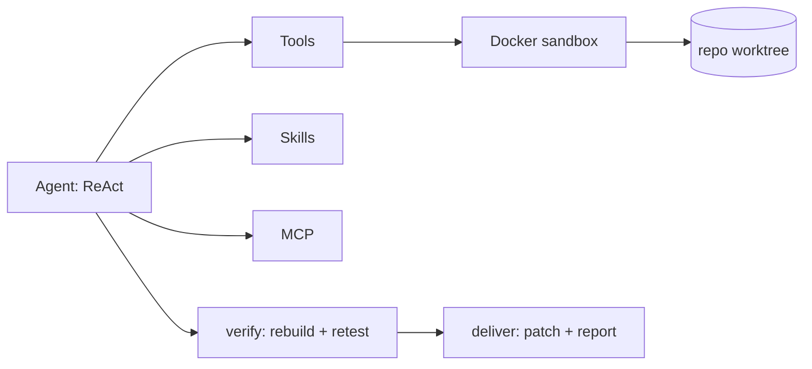

# Java Repair Agent

[](https://github.com/u7465990/java-repair-agent/actions/workflows/ci.yml)
[](https://github.com/u7465990/java-repair-agent/actions/workflows/d4j-smoke.yml)
[](LICENSE)
[](pyproject.toml)

An autonomous Java bug-fixing agent. The model decides what to read, search, change and test;
a deterministic verification gate decides whether the bug is actually fixed.

**Status: v0.3.** First end-to-end repair: `Lang-1` fixed by `qwen-plus` in 2 attempts
inside CI, trigger test passing with no new failures. Durable lifecycle graph, skills and MCP
are next (see [roadmap](#roadmap)).

## Why it looks like this

- **Free agent, deterministic gate.** One ReAct agent calls tools freely; only `prepare`,
  `verify` and `deliver` are fixed.
- **Tools, skills, MCP.** 15+ tools (files, shell, JDT symbols, tests, git), on-demand
  `SKILL.md` knowledge, and bidirectional MCP integration.
- **Sandboxed execution.** Every command runs in Docker with a mounted worktree and no network.
- **Evaluation first.** Defects4J provides the oracle: trigger tests (F2P) plus regression
  tests (P2P). The agent never sees the fix commit.



## Quickstart

```bash
uv sync
uv run java-agent doctor
uv run java-agent version
```

No Docker required for the unit tests:

```bash
uv run pytest -q
uv run ruff check .
```

## Run one Defects4J bug

Build the sandbox image once (JDK 8 + 11, Perl, Defects4J, warm repositories):

```bash
docker build -f docker/Dockerfile.d4j -t d4j-runner:2.0 .
```

Then checkout, compile and print the baseline failures:

```bash
uv run java-agent d4j smoke -p Lang -b 1
```

The checkout lands in `work/Lang-1/repo`; the container is removed afterwards.
On a machine without a fast network, the same flow runs in GitHub Actions:
trigger the `d4j-smoke` workflow instead of building locally.

### Verified baseline (Lang-1)

```text
compile: ok
trigger tests: 1
baseline failing: 3
  - org.apache.commons.lang3.math.NumberUtilsTest::TestLang747
  - org.apache.commons.lang3.time.DateUtilsTest::testLANG799_DE_OK
  - org.apache.commons.lang3.time.DateUtilsTest::testLANG799_EN_WITH_DE_LOCALE
```

The trigger test fails as expected. The two `DateUtilsTest` failures are
locale-dependent and exist independently of the bug: this is exactly why
verification compares against the baseline failing set instead of requiring an
all-green suite.

## Let the agent fix it

```bash
uv add langchain-anthropic        # or langchain-openai / langchain-deepseek
export ANTHROPIC_API_KEY=...
export JAVA_AGENT_MODEL=anthropic:claude-sonnet-4-5

uv run java-agent run -p Lang -b 1
```

The agent gets read/search/edit/bash/test tools and works inside the sandbox.
After every attempt an independent verification step rebuilds and retests the
repository, compares failures against the baseline, and feeds the report back.
Artifacts land in `work/Lang-1/`: `patch.diff`, `verify.log`, `baseline-test.log`.

## Results

| Bug | Model | Attempts | Outcome |
|---|---|---|---|
| Lang-1 | `qwen-plus` (DashScope compatible API) | 2 | trigger passes, no new failures, 11 min |

The first attempt patched `NumberUtils.createNumber` with a try/catch fallback and failed
verification; the second attempt replaced the hex-digit heuristic with a `BigInteger`
bit-length check and passed. Only production source was modified.
Smaller `qwen-flash` did not localise the bug (it spent its budget exploring); `qwen-plus`
was the smallest model that worked.

Run it yourself with the `agent-run` workflow (`workflow_dispatch`, model
`openai:qwen-plus`), or locally after building the sandbox image.

## Layout

| Path | Purpose |
|---|---|
| `src/java_agent/sandbox/` | Local and Docker execution backends |
| `src/java_agent/d4j.py` | Defects4J commands and output parsing |
| `src/java_agent/eval/` | Case definition and baseline runner |
| `src/java_agent/cli.py` | `java-agent` commands |
| `docker/Dockerfile.d4j` | Sandbox image with Defects4J |
| `docker/Dockerfile.app` | Self-contained release image |
| `docs/architecture.md` | Design: graph, tools, skills, MCP, evaluation |
| `tests/` | Unit tests (no Docker, no LLM) |

## Roadmap

- [x] Sandbox abstraction (local + Docker)
- [x] Defects4J adapter and baseline runner
- [x] CLI: `doctor`, `d4j smoke`
- [x] LangGraph ReAct agent with tool calling
- [x] Tools: read / write / edit / search / bash / run_tests / git_diff
- [x] Independent verification against the baseline failure set
- [ ] Durable lifecycle graph (checkpointer, interrupts)
- [ ] SKILL.md loader + built-in skills
- [ ] MCP client/server
- [ ] Evaluation report over 10-20 bugs

## Safety

- Containers run with `--network none` and a single mounted workspace.
- The agent cannot modify tests or build files; `verify` checks file hashes.
- Do not run untrusted MCP servers or expose the API without additional isolation.

## License

MIT. See [LICENSE](LICENSE).
